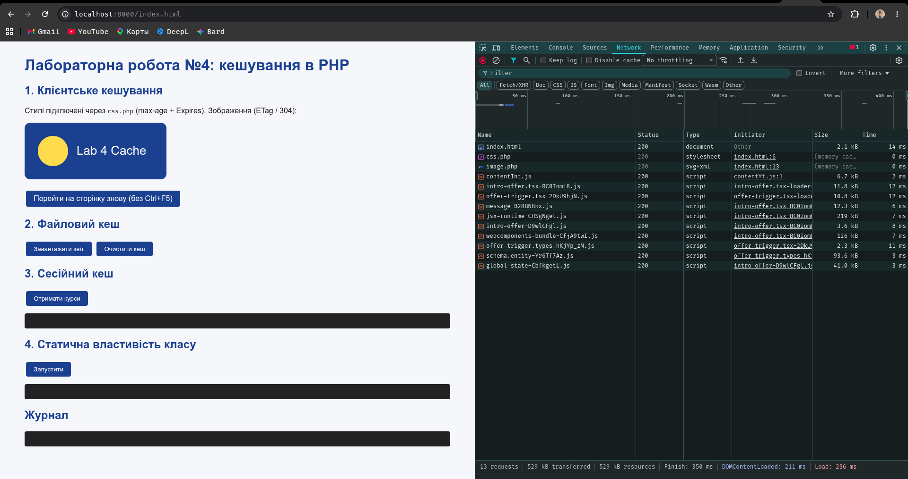
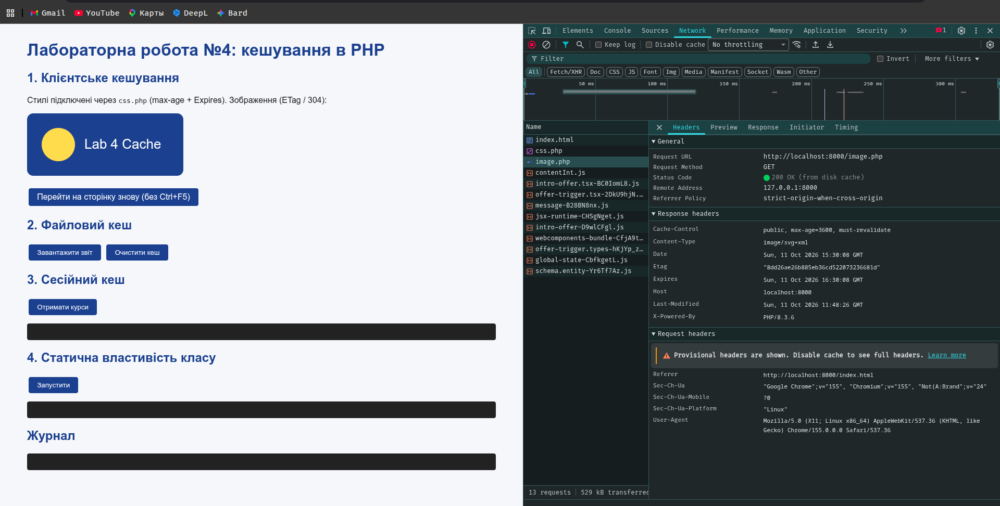
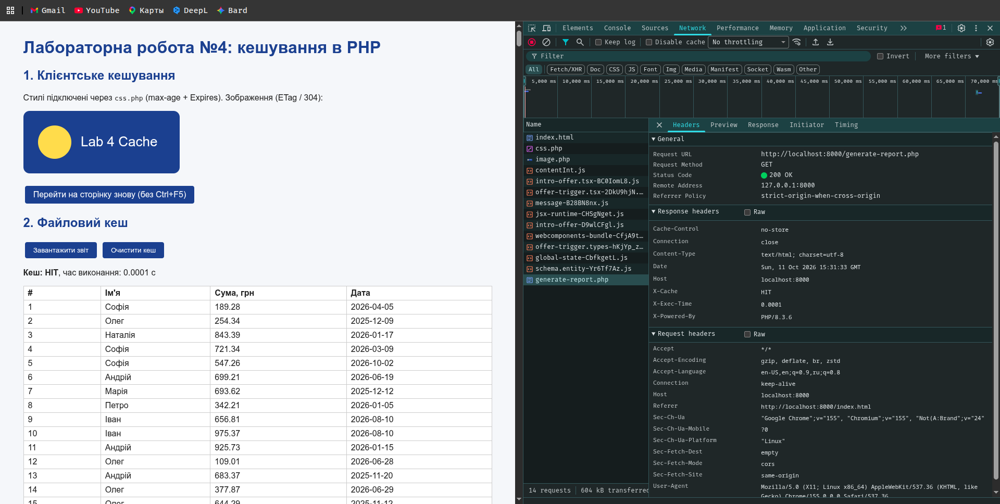
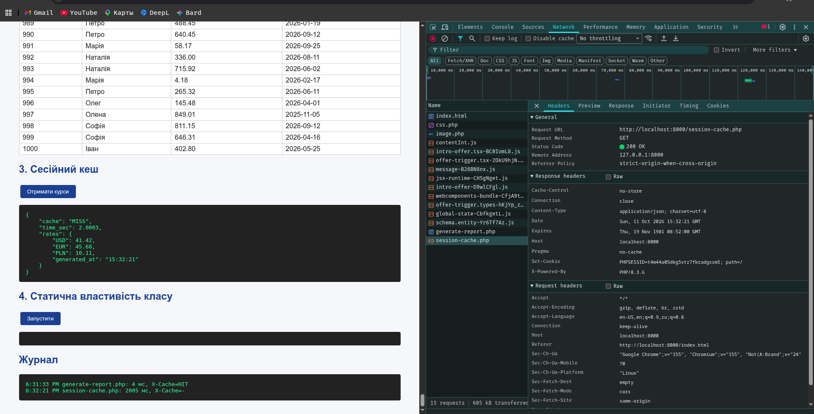
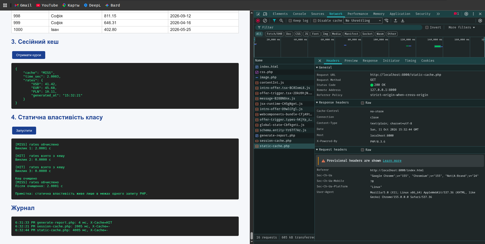
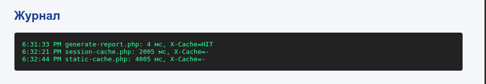

# Звіт з лабораторної роботи №4
**Тема:** Робота з кешем в Web на PHP
**Мета:** ознайомитися з механізмами кешування, реалізувати клієнтське (HTTP-заголовки) та серверне (файл, сесія, статична властивість) кешування в PHP.

## 1. Структура проєкту
| Файл | Призначення |
|---|---|
| css.php | CSS з Cache-Control, Expires (клієнтський кеш, приклад 1) |
| image.php | SVG-зображення з ETag/Last-Modified та відповіддю 304 (приклад 2) |
| generate-report.php | Файловий кеш звіту на 1000 рядків, TTL 10 хв |
| session-cache.php | Кеш курсів валют у `$_SESSION` |
| static-cache.php | Клас `StaticCache` зі статичною властивістю |
| clear-cache.php | Очищення файлового й сесійного кешу |
| index.html | Клієнтський код: підключення ресурсів, fetch-запити, замір часу |

## 2. Запуск
```
cd lab4
php -S localhost:8000
```
Відкрити http://localhost:8000/index.html

## 3. Пояснення реалізації
### 3.1 Клієнтське кешування
- **css.php** надсилає `Cache-Control: public, max-age=86400`, `Expires` (+1 день) і `Content-Type: text/css`. Браузер упродовж доби не звертається до сервера по цей файл.
- **image.php** використовує валідацію: `ETag` і `Last-Modified`. Коли термін max-age минув, браузер надсилає `If-None-Match` / `If-Modified-Since`; якщо ресурс не змінився, сервер повертає `304 Not Modified` без тіла.

**Важливо для перевірки:** F5 та Ctrl+F5 примусово обходять кеш. Потрібно переходити по посиланню або відкривати сторінку знову (Enter в адресному рядку). У DevTools → Network колонка Size має показувати *(disk cache)* / *(memory cache)*, а Status — 200 (from cache) або 304.

### 3.2 Файловий кеш (generate-report.php)
Перевіряється, чи існує `cache/report.html` і чи його `filemtime` молодший за 10 хвилин. Так — вміст читається одразу (X-Cache: HIT). Ні — виконується `sleep(3)`, генерується 1000 рядків, файл перезаписується з `LOCK_EX` (X-Cache: MISS). Час виконання виводиться на сторінці, в заголовку `X-Exec-Time` та в `error_log`.

### 3.3 Сесійний кеш (session-cache.php)
Результат обчислення (`sleep(2)`) зберігається в `$_SESSION['rates_cache']`. Наступні запити в межах сесії повертають дані миттєво. Кеш індивідуальний для кожного користувача.

### 3.4 Статична властивість класу (static-cache.php)
`StaticCache::$store` — статичний масив, метод `remember($key, $producer)` обчислює значення лише раз. Кеш живе тільки в межах одного PHP-запиту (після завершення скрипта пам'ять звільняється), тому демонстрація — три виклики підряд в одному запиті: перший ≈ 2 с, наступні ≈ 0 с.

## 4. Результати тестування (очікувані; замініть своїми)
| Сценарій | Без кешу | З кешем |
|---|---|---|
| generate-report.php | ≈ 3,0 с (MISS) | ≈ 0,001–0,01 с (HIT) |
| session-cache.php | ≈ 2,0 с (MISS) | ≈ 0,0001 с (HIT) |
| static-cache.php | 1-й виклик ≈ 2,0 с | 2-й і 3-й ≈ 0,0000 с |
| css.php (Network) | 200, Size = розмір файлу | 200 (disk cache), 0 B |
| image.php | 200 | 304 / (memory cache) |

Після `clear-cache.php` перший запит знову MISS, дані (випадкові суми, курси, час генерації) змінюються — це підтверджує очищення кешу.

## 5. Скриншоти (додати власні)
1. DevTools → Network: css.php — перше завантаження (Size у байтах) і повторне (*disk cache*).

2. Network: image.php — заголовки ETag/Last-Modified та 200 OK (from disk cache).

3. Сторінка зі звітом: «Кеш: MISS, 3.0 с» → «Кеш: HIT, 0.00x с».

4. Відповідь session-cache.php: MISS → HIT.

5. Вивід static-cache.php з часом кожного виклику.

6. Блок «Журнал» на index.html.


## 6. Висновки
Клієнтське кешування розвантажує мережу й сервер, бо ресурс не передається повторно. Серверне кешування зменшує час відповіді, пропускаючи дорогі обчислення. Файловий кеш спільний для всіх користувачів і переживає запити; сесійний — персональний; статична властивість — найшвидша, але існує лише в межах одного запиту. Для кожного підходу потрібна стратегія інвалідації (TTL, ручне очищення).
